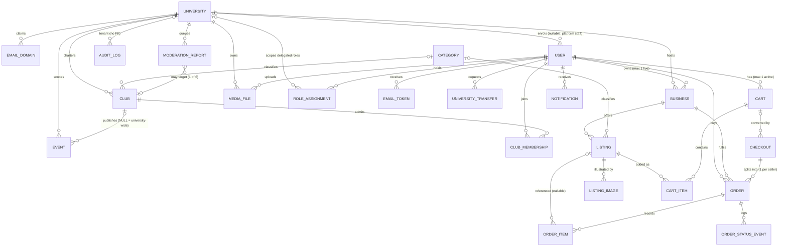
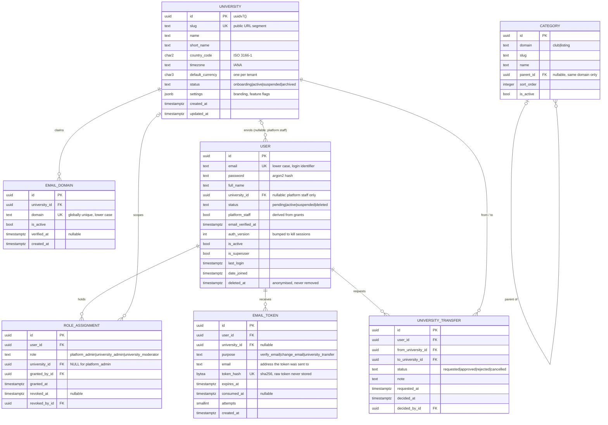
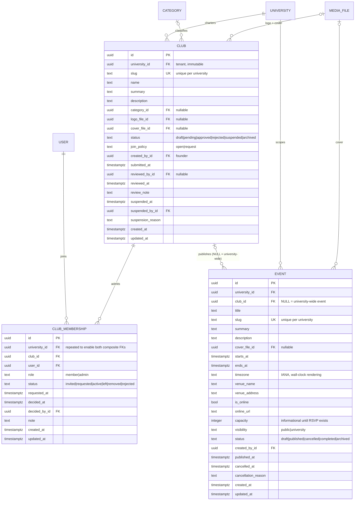
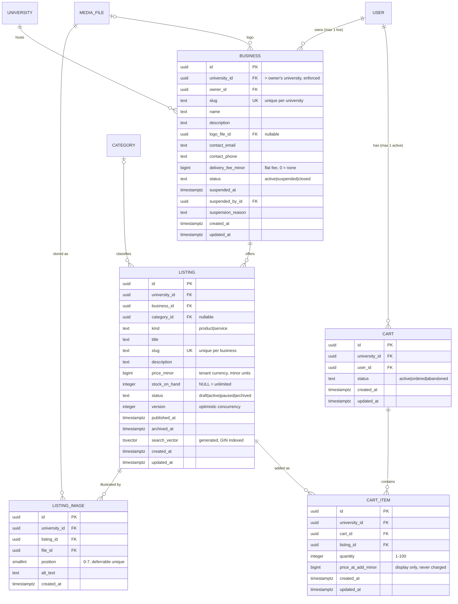
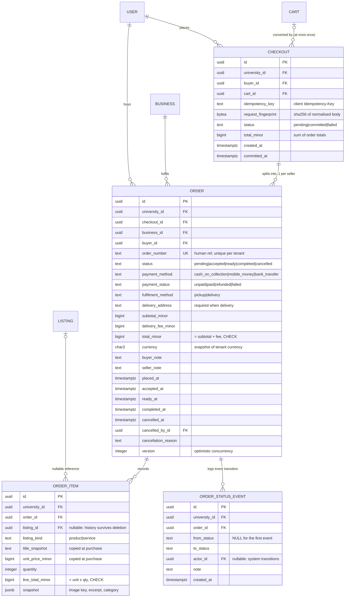
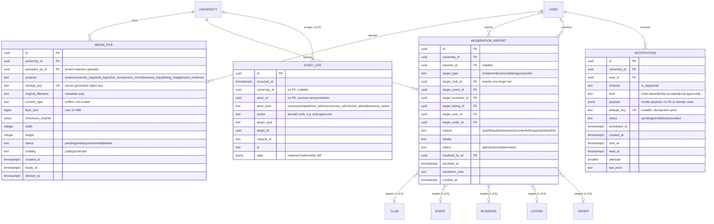
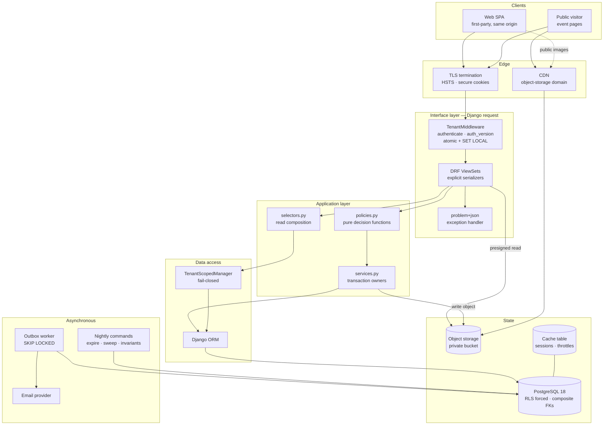
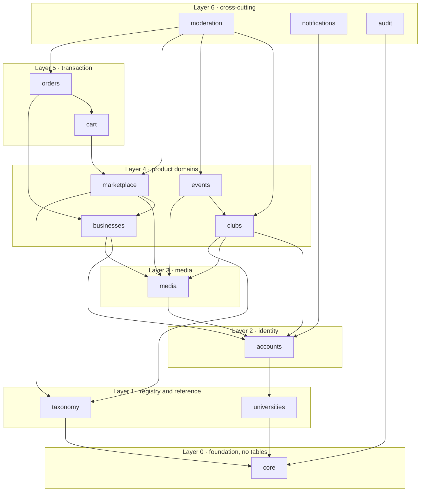
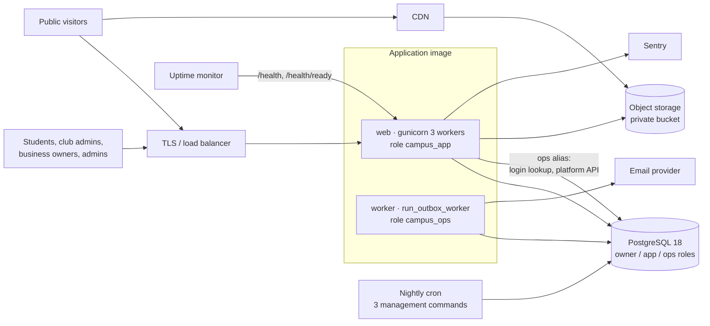
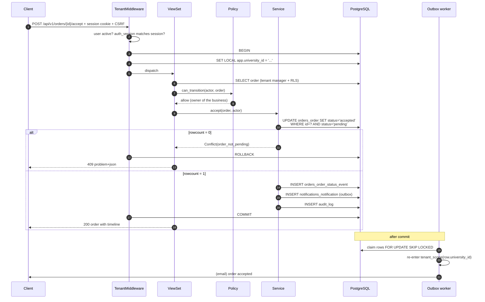

# Campus Hub — Diagram Pack and Django App Inventory

**Version** 1.0 · **Date** 16 November 2026

Companion to `Campus-Hub-Architecture-Spec.md` (Parts VI and VIII) and `schema.sql`.
Where a diagram and `schema.sql` disagree, `schema.sql` is correct.

## How to read the diagrams

| Convention | Meaning |
|---|---|
| One ERD per bounded context | Mermaid `erDiagram` has no subgraphs, so grouping is expressed by splitting the model into five context diagrams plus one overview. A giant single ERD is technically complete and practically unreadable |
| `PK` / `FK` / `UK` | Primary key, foreign key, unique key. Where a key is scoped ("unique per tenant") the comment says so |
| Type names | Real PostgreSQL types (`uuid`, `text`, `timestamptz`, `bigint`, `jsonb`, `tsvector`, `char3`) |
| 🔒 in a caption | Every table in that diagram has `ENABLE` + `FORCE ROW LEVEL SECURITY` except the registry/reference tables named in the caption |
| Cross-context boxes without attributes | The entity is defined in another diagram; here it is only an FK target |
| Composite FK | Written in text as `(child_col, university_id) → parent(id, university_id)`. This is the mechanism that makes a cross-tenant reference impossible |

**Validation.** All diagrams were syntax-checked by a custom linter (balanced blocks, valid
cardinality tokens, every attribute line well formed, entity names consistent); they were not
rendered, because no Mermaid renderer was available offline. Rendering is deterministic from
valid syntax, but treat the first GitHub/IDE render as the visual check.

---

# Part 1 — Database Architecture

## 1.1 D1 · Overview: the whole model in one page

Relationship map only — no columns. Read it as "what owns what"; the five context diagrams
below carry the attributes.

Three things to notice:

1. **Everything hangs off `UNIVERSITY`** except reference data. That is the tenant boundary,
   drawn once.
2. **`CHECKOUT` sits between `CART` and `ORDER`** because a checkout is the atomic conversion
   event and the idempotency anchor; orders are its children, one per seller.
3. **`MODERATION_REPORT` has six nullable target FKs** (club, event, business, listing, user,
   order) of which exactly one is non-null — only one is drawn to keep the map legible.

## 1.2 D2 · Identity, tenancy and reference data

🔒 RLS on `USER`, `ROLE_ASSIGNMENT`, `EMAIL_TOKEN`, `UNIVERSITY_TRANSFER`.
No RLS by design on `UNIVERSITY` and `EMAIL_DOMAIN` (registry: registration must resolve a
domain to a tenant before any identity exists) and on `CATEGORY` (global reference data).

**Key invariants**

| Invariant | Mechanism |
|---|---|
| A user has exactly one university at a time | `USER.university_id` is a single column; `UNIQUE (id, university_id)` is the anchor for every composite FK |
| A domain maps to exactly one university | `EMAIL_DOMAIN.domain` is globally `UNIQUE` |
| One live grant per (user, role, scope) | Partial unique index on `(user_id, role, university_id) NULLS NOT DISTINCT WHERE revoked_at IS NULL` |
| A platform admin has no tenant; a tenant role must have one | `role_assignment_scope_check` |
| An active account must have a tenant unless it is platform staff | `user_active_scope_check` |
| Verification tokens are single-use and hashed | `token_hash` unique + `consumed_at` + 24 h expiry |
| A transfer never moves a user to the same tenant | `from_university_id <> to_university_id` |

## 1.3 D3 · Event Hub

🔒 All three tables RLS-enabled. `CLUB.slug` and `EVENT.slug` are unique **per tenant**.

**Why the membership table carries `university_id` twice over:** it is the pivot that lets the
row hold `(club_id, university_id) → clubs_club(id, university_id)` **and**
`(user_id, university_id) → accounts_user(id, university_id)` at the same time. Because both
FKs share one column, a member from another university is not "rejected" — the row cannot be
inserted at all.

**Invariants and where they live**

| Invariant | Mechanism |
|---|---|
| A club's members belong to the club's university | Two composite FKs on `CLUB_MEMBERSHIP` |
| One row per (club, user) — re-joining reuses it | `UNIQUE (club_id, user_id)` |
| Only approved clubs publish events | Trigger T1 `event_publisher_approved` + service guard |
| An approved club keeps an active admin | Deferred constraint trigger T2 (checked at COMMIT) |
| An event cannot belong to a foreign club or a foreign creator | Composite FKs on `EVENT` |
| An event ends after it starts; an in-person event has a venue | `event_time_check`, `event_location_check` |
| Cancelled means timestamped | `event_cancelled_check` |

## 1.4 D4 · Marketplace catalogue and cart

🔒 All five tables RLS-enabled. Note the deliberate separation: the **cart** is buyer-owned and
mutable; the **catalogue** is seller-owned. They meet only at `LISTING`.

**Invariants and where they live**

| Invariant | Mechanism |
|---|---|
| A business's university is its owner's university | `business_owner_fk (owner_id, university_id)` |
| One live business per student | Partial unique `(owner_id) WHERE status <> 'closed'` |
| A listing belongs to a business in the same university | `listing_business_fk (business_id, university_id)` |
| A product declares stock; a service may not | `listing_stock_required_check` |
| Sold-out is derived, never stored | `stock_on_hand = 0`, no `sold_out` status |
| One active cart per user | Partial unique `(user_id) WHERE status='active'` |
| One line per listing per cart (quantity aggregates) | `UNIQUE (cart_id, listing_id)` |
| A cart line cannot reference a foreign listing | `cart_item_listing_fk (listing_id, university_id)` |

## 1.5 D5 · Checkout and orders

🔒 All four tables RLS-enabled; the application role has **no DELETE** on any of them
(append-only financial history).

**Invariants and where they live**

| Invariant | Mechanism |
|---|---|
| A cart converts at most once, even with a new idempotency key | Partial unique `(cart_id) WHERE status='committed'` |
| The same key with a different body is refused | `UNIQUE (university_id, buyer_id, idempotency_key)` + fingerprint comparison |
| One order per seller per checkout | `UNIQUE (checkout_id, business_id)` |
| Totals add up | `CHECK (total_minor = subtotal_minor + delivery_fee_minor)` |
| A delivery order has an address | `order_delivery_address_check` |
| An order cannot reference a foreign buyer, business or checkout | Three composite FKs |
| History survives a deleted listing | `ON DELETE SET NULL (listing_id)` + snapshot columns |
| Every transition is attributable | `orders_order_status_event` written in the same transaction |

## 1.6 D6 · Platform services: media, moderation, notifications, audit

🔒 All four RLS-enabled. `AUDIT_LOG` is append-only at the grant level (`INSERT, SELECT` only)
and intentionally has **no foreign keys** — an audit row must outlive the actor and the object.

**Why the moderation target is five columns instead of one `target_id`:** a polymorphic
`(target_type, target_id)` pair cannot be a foreign key, cannot be joined, and must be
re-validated in every consumer. Five nullable columns plus `num_nonnulls(...) = 1` and
`report_target_matches_type` give real referential integrity and a composite tenant FK per
target.

## 1.7 Table → context → isolation map

| Table | Context | Tenant column | RLS |
|---|---|---|---|
| `universities_university` | D2 registry | *is* the tenant | no (registry) |
| `universities_email_domain` | D2 registry | `university_id` | no (registry, documented) |
| `taxonomy_category` | D2 reference | — | no (global reference) |
| `accounts_user` | D2 identity | `university_id` (nullable) | 🔒 |
| `accounts_role_assignment` | D2 identity | `university_id` (nullable) | 🔒 |
| `accounts_email_token` | D2 identity | `university_id` (nullable) | 🔒 |
| `accounts_university_transfer` | D2 identity | `from_` / `to_university_id` | 🔒 |
| `clubs_club` | D3 event hub | `university_id` | 🔒 |
| `clubs_membership` | D3 event hub | `university_id` | 🔒 |
| `events_event` | D3 event hub | `university_id` | 🔒 |
| `businesses_business` | D4 catalogue | `university_id` | 🔒 |
| `marketplace_listing` | D4 catalogue | `university_id` | 🔒 |
| `marketplace_listing_image` | D4 catalogue | `university_id` | 🔒 |
| `cart_cart` | D4 cart | `university_id` | 🔒 |
| `cart_cart_item` | D4 cart | `university_id` | 🔒 |
| `orders_checkout` | D5 orders | `university_id` | 🔒 |
| `orders_order` | D5 orders | `university_id` | 🔒 |
| `orders_order_item` | D5 orders | `university_id` | 🔒 |
| `orders_order_status_event` | D5 orders | `university_id` | 🔒 |
| `media_file` | D6 platform | `university_id` | 🔒 |
| `moderation_report` | D6 platform | `university_id` | 🔒 |
| `notifications_notification` | D6 platform | `university_id` | 🔒 |
| `audit_log` | D6 platform | `university_id` (nullable) | 🔒 |

23 tables · 20 RLS-enabled · 3 deliberate registry/reference exceptions, each argued in
Part V §5.5 of the specification.

---

# Part 2 — Backend Architecture

## 2.1 B1 · Layered components

**Layer rules, in one line each**

| Layer | May | Must not |
|---|---|---|
| Interface | Parse HTTP, choose a serializer, call a policy or service | Contain business rules, open transactions, or query another app's models |
| Policy | Decide with data already loaded | Write, or issue more than a trivial lookup |
| Service | Own the transaction, enforce invariants, write audit + outbox | Speak HTTP, return `Http404`, commit another app's transaction |
| Selector | Compose a read queryset for one caller | Bypass the tenant manager |
| Data access | Fail closed on a missing tenant | Silently fall back to `all()` |

## 2.2 B2 · Django app dependency graph

Arrows point from a dependent app to the app it depends on. To keep the graph readable, two
edges that every app has are omitted: **everything depends on `core`**, and **every
tenant-owning app depends on `universities`**. Both are listed explicitly in §3.1.

**Prohibited edges** (enforced by `import-linter` in CI, not by convention):

| Prohibited | Why |
|---|---|
| `core` → any domain app | It is the bottom of the graph; one import makes everything circular |
| `accounts` → `clubs` / `marketplace` / `orders` | Identity must not know about content |
| `media` → any entity app | Media owns files, not the things they illustrate |
| any app → `moderation` | Moderation reacts; if domains import it, they couple to reports |
| `audit` → any domain app | Audit takes primitives (`target_type`, `target_id`), never model classes |
| `*/api/*` → `all_objects` | The escape hatch must never reach the request path |
| `*/services.py` → `rest_framework` | Services must be usable from workers and commands |

## 2.3 B3 · Runtime topology (MVP)

Two processes, one database, one bucket, no Redis and no broker. The `ops` connection is drawn
separately because it is the only `BYPASSRLS` path and must stay visible in the architecture.

## 2.4 B4 · Write path, end to end

The diagram that explains the whole design: one request, one transaction, one tenant, one
guarded state transition, one outbox row.

The two details that matter most: `SET LOCAL` is issued **after** `BEGIN` and dies with the
transaction, and the state transition is a **guarded `UPDATE`** rather than read-then-write, so
two simultaneous transitions resolve to exactly one winner.

## 2.5 Component responsibilities

| Component | Owns | Never does |
|---|---|---|
| `core.tenancy` | Tenant resolution, `SET LOCAL`, request transaction | Decide authorisation |
| `core.permissions` | Which *kind* of actor may call an endpoint | Query the object (it does not exist yet) |
| `policies.py` | Whether *this* actor may act on *this* object | Write, or open a transaction |
| `services.py` | Transactions, invariants, ordering of side effects | Speak HTTP |
| `selectors.py` | Read composition per caller | Skip the tenant filter |
| `TenantScopedManager` | Fails closed when no tenant is set | Provide a silent `all()` |
| RLS + constraints | Row visibility and structural truth | Express actor-dependent rules |
| Outbox worker | Delivery under a per-row tenant context | Read domain tables speculatively |

---

# Part 3 — Django App Inventory

Fourteen **MVP** apps, nine **post-MVP** apps. A post-MVP app is listed only if there is a
named trigger for building it — "we might need it" is not a trigger.

## 3.1 MVP apps

| # | App | Label | Phase | Owns tables | Responsibility | Depends on |
|---|---|---|---|---|---|---|
| 1 | `core` | **MVP** | 0 | — (abstract models only) | Tenant middleware and `SET LOCAL`, scoped managers, DRF base permissions, problem+json handler, pagination, idempotency helper, S3 adapter, image validation, exceptions | — |
| 2 | `universities` | **MVP** | 1 | `university`, `email_domain` | Tenant registry, institutional email domains, per-tenant settings (branding, currency, timezone), onboarding | `core` |
| 3 | `taxonomy` | **MVP** | 1 | `category` | Global two-level category tree for clubs and listings; seeded reference data | `core` |
| 4 | `accounts` | **MVP** | 1 | `user`, `role_assignment`, `email_token`, `university_transfer` | Registration, email verification, login/logout, password reset and change, delegated role grants, suspension, anonymisation, tenant transfer | `core`, `universities` |
| 5 | `media` | **MVP** | 1 | `file` | Upload validation and re-encoding, storage keys, public/protected delivery, slots and citation rules, orphan sweep | `core`, `universities`, `accounts` |
| 6 | `clubs` | **MVP** | 2 | `club`, `membership` | Club lifecycle (draft → pending → approved/rejected → suspended → archived), join policy, membership and club-level admin roles, last-admin rule | `core`, `universities`, `accounts`, `media`, `taxonomy` |
| 7 | `events` | **MVP** | 2 | `event` | Event lifecycle, publishing rules (approved clubs only), material-change audit, cancellation, discovery feed, public projection | `core`, `universities`, `accounts`, `clubs`, `media` |
| 8 | `notifications` | **MVP** | 2 | `notification` | Transactional outbox, in-app inbox, email rendering, dedupe keys, retry/backoff, `run_outbox_worker` | `core`, `universities`, `accounts` |
| 9 | `audit` | **MVP** | 1 | `audit_log` | Append-only record of privileged and financial actions; `record()` used by services; tenant-filtered reader | `core`, `universities` |
| 10 | `businesses` | **MVP** | 3 | `business` | Seller identity, one-live-business rule, suspension, delivery fee, ownership transfer (platform-only) | `core`, `universities`, `accounts`, `media` |
| 11 | `marketplace` | **MVP** | 3 | `listing`, `listing_image` | Catalogue: products and services, stock or unlimited, pricing, images, search (PostgreSQL FTS + trigram), optimistic concurrency | `core`, `universities`, `accounts`, `businesses`, `media`, `taxonomy` |
| 12 | `cart` | **MVP** | 4 | `cart`, `cart_item` | One active cart per buyer, add/merge/update/remove, availability flags, price-at-add display | `core`, `universities`, `accounts`, `marketplace` |
| 13 | `orders` | **MVP** | 4 | `checkout`, `order`, `order_item`, `order_status_event` | Checkout transaction (locks, stock decrement, snapshot, idempotency), per-seller split, order state machine, payment *status*, timeline | `core`, `universities`, `accounts`, `businesses`, `marketplace`, `cart` |
| 14 | `moderation` | **MVP** | 5 | `report` | Reports against six target types, moderation queue, resolution that delegates the remedy to the owning domain | `core`, `universities`, `accounts`, `clubs`, `events`, `marketplace`, `orders` |

**Total MVP: 14 apps · 23 tables.**

Reading the table as a build order: `core` first, then Phase 1 (registry + identity + media),
then Phase 2 (Event Hub), Phase 3 (catalogue), Phase 4 (the money path), Phase 5 (trust and
safety). That matches Part XVI of the specification.

## 3.2 Post-MVP apps

| # | App | Label | Trigger to build it | New tables | Depends on | Cost if built early |
|---|---|---|---|---|---|---|
| 1 | `payments` | **POST-MVP** | A university or seller requires in-app payment, or a university supplies its M-Pesa shortcode | `payment`, `payment_webhook_event`, `payment_reconciliation` | `core`, `orders` | High: gateway integration, reconciliation, refunds and dispute handling before there is any volume to justify them |
| 2 | `ticketing` | **POST-MVP** | A club asks to sell tickets or cap attendance | `event_rsvp`, `ticket`, `ticket_check_in` | `core`, `events`, `payments`, `notifications` | High: capacity concurrency, refunds and check-in UI; the schema's `capacity` stays informational until then |
| 3 | `billing` | **POST-MVP** | The first paid university licence or Seller Pro subscription (Part XX commercial model) | `plan`, `subscription`, `invoice`, `billing_event` | `core`, `universities`, `businesses` | Medium: invoicing and dunning for revenue that does not exist yet |
| 4 | `promotions` | **POST-MVP** | Sellers ask for visibility, or the first paid boost is sold | `promotion_campaign`, `promotion_slot`, `promotion_impression` | `core`, `marketplace` | Low-medium: ranking rules and disclosure (a paid placement must be labelled) |
| 5 | `messaging` | **POST-MVP** | Support tickets show that buyer/seller notes are insufficient — measured, not guessed | `thread`, `message`, `thread_participant` | `core`, `orders` | Medium: a second real-time-ish surface with its own moderation burden |
| 6 | `reviews` | **POST-MVP** | ≥ 100 completed orders, so a rating is statistically meaningful | `review`, `rating_summary` | `core`, `orders`, `businesses` | Medium: ratings without volume are noise and invite retaliation |
| 7 | `analytics` | **POST-MVP** | A university asks for a termly engagement report (this is also a renewal lever) | Mostly read-only views/materialised views; `report_snapshot` if exports are needed | `core` (reads everything) | Low code, high value — but it must read through the platform path, never a tenant session |
| 8 | `integrations` | **POST-MVP** | A university requires SSO (SAML/OIDC) or a roster feed for automatic verification | `identity_provider`, `roster_entry`, `sync_run` | `core`, `universities`, `accounts` | Medium-high: per-tenant configuration, certificate rotation, sync failure handling |
| 9 | `delivery` | **POST-MVP** | Orders per week exceed what sellers can hand-deliver, or a university wants campus pickup points | `delivery_zone`, `delivery_assignment`, `pickup_point` | `core`, `orders`, `businesses` | Medium: courier coordination is an operations business, not a feature |

**Total post-MVP: 9 apps · ~20 potential tables** — none of which exist in `schema.sql` today,
and none of which the MVP design blocks.

### Explicitly *not* planned as an app

| Candidate | Why not |
|---|---|
| `search` | PostgreSQL full-text + trigram is enough for tens of thousands of listings. If it stops being enough, that is an infrastructure swap (Meilisearch/Typesense) behind `marketplace.selectors`, not a new domain app |
| `api` / `common` / `utils` | An app with no owner becomes the place where boundaries go to die. Routers live in each app's `api/urls.py`; shared code lives in `core` only with a stated contract |
| `notifications_push` | Push is a channel inside `notifications` (a new `channel` value + a provider adapter), not a domain |
| `admin_panel` | Platform administration is an API surface (`/api/v1/platform/`) plus templates, not a Django app with models |
| `payments_wallet` | Holding student balances is a regulated activity, not a feature flag |

## 3.3 Rules for adding an app

1. **It must own at least one table that no other app may write.** Otherwise it is a module
   inside an existing app (`selectors.py`, `policies.py`).
2. **It enters at one layer and depends downwards only.** Add the edge to the diagram in §2.2
   and to the `import-linter` layer contract in the same pull request.
3. **One service function per use case, and it owns the transaction.** No app may call another
   app's model `.save()`.
4. **If it has a `university_id` column, it needs an RLS migration in the same release** —
   `ENABLE`, `FORCE`, one `tenant_isolation` policy, and a row in the §1.7 map.
5. **It ships with its tests**: at minimum one isolation test (TS-02 style) and one
   permission-matrix test per endpoint.
6. **Name it after the domain, not the table.** `orders`, not `order_items`; `marketplace`, not
   `listings`.

## 3.4 Counting the boundary

| Metric | MVP | With all post-MVP apps |
|---|---|---|
| Django apps | 14 | 23 |
| Tables | 23 | ~43 |
| RLS policies | 20 | ~38 |
| Deployment units | 1 image, 2 processes | unchanged |

The point of the post-MVP list is not that all nine will be built. It is that each has a named
trigger, so "should we build this now?" has an answer that is not a matter of taste — and so the
MVP schema can be reviewed against them once, rather than redesigned later.
