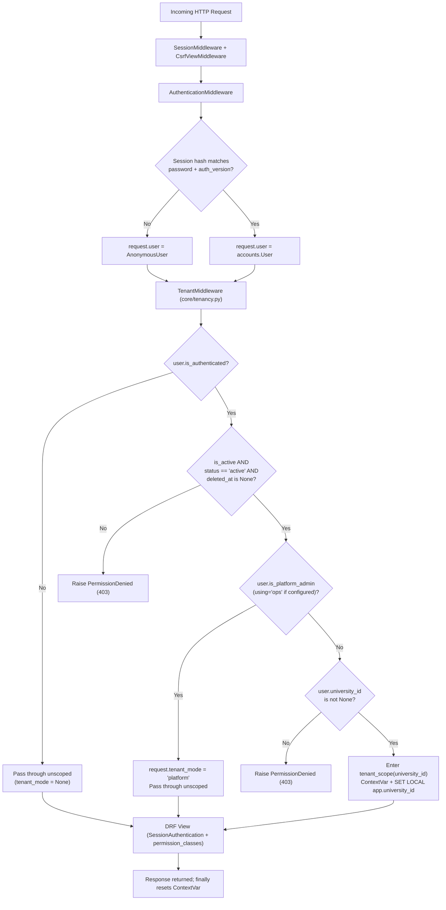
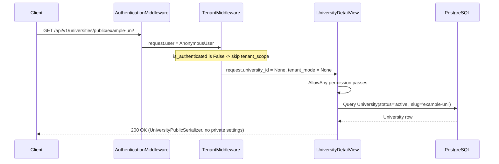
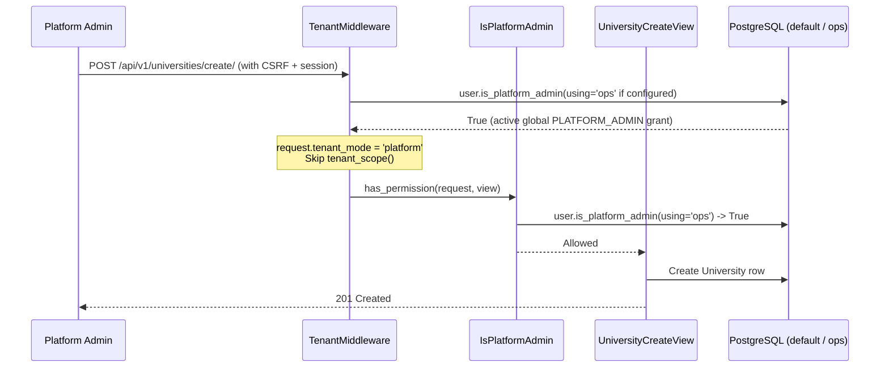

# Authentication, Middleware, and Permissions Guide

This document explains how **authentication**, **tenant middleware**, and **permissions** work together in CampusHub 3.0. It is written for new developers joining the project so you can understand the request lifecycle, safely build new features, or refactor existing components without breaking tenant isolation.

---

## 1. Core Architectural Philosophy

CampusHub is a **multi-tenant** platform where each `University` is an isolated tenant. Almost every domain record belongs to a single university, and the architecture is built around two principles:

1. **Fail closed by default.** If a request is missing a valid user, an active account status, or a tenant context when one is required, the system rejects the request or returns an empty/error result rather than falling back to unscoped data.
2. **Defense in depth.** Tenant boundaries are enforced at multiple layers:
   - **Authentication layer** (blocks inactive, pending, suspended, or deleted accounts; invalidates sessions when security state changes).
   - **Middleware layer** (establishes per-request Python `ContextVar` state and PostgreSQL transaction-local `app.university_id`).
   - **Permission & selector layer** (verifies role grants and filters querysets by tenant or `ops` database alias).
   - **ORM manager layer** (`TenantScopedManager` refuses to run unscoped queries when no tenant is active).

> **Note on Row-Level Security (RLS):** `TenantMiddleware` already sets PostgreSQL's `app.university_id` setting per transaction, and `TenantScopedManager` is ready for domain models. However, database-level RLS policies are **not yet enabled** in migrations and remain a separate release gate (see `docs/implementation plan.md` §9). Today, isolation relies on middleware, selectors, managers, and permissions working together.

---

## 2. Key Technologies and What They Do

| Technology | Package / Module | Role in CampusHub |
|---|---|---|
| **Django 6.1.3** | `django.contrib.auth`, `sessions`, `db` | Core web framework, ORM, migration history, session management, and `AbstractUser` extension (`accounts.User`). |
| **Django REST Framework 3.18.3** | `rest_framework` | API layer (`generics` views, serializers, `SessionAuthentication`, `BasePermission` classes). |
| **PostgreSQL 18** | `psycopg` 3.3.9 | The **only** supported database (`config/settings.py` rejects non-PostgreSQL `DATABASE_URL`s). Supports `set_config('app.university_id', ..., true)` for transaction-scoped tenant context and an optional `ops` database alias (`OPS_DATABASE_URL`) for platform-wide queries. |
| **Argon2** | `argon2-cffi` | Primary password hasher configured in `PASSWORD_HASHERS` (`Argon2PasswordHasher`). |
| **Python `contextvars`** | `core/tenancy.py` | Stores `_current_university_id` safely per request/async context without thread-local leakage. |
| **UUIDv7** | `uuid6` | Time-ordered UUID primary keys (`default=uuid6.uuid7`) across `User`, `University`, `EmailDomain`, `RoleAssignment`, and `EmailToken`. |
| **`dj-database-url` & `python-dotenv`** | `config/settings.py` | Loads `.env` and parses `DATABASE_URL` and optional `OPS_DATABASE_URL`. |
| **`django-cors-headers`** | `corsheaders.middleware.CorsMiddleware` | Handles Cross-Origin Resource Sharing for the web client (`CORS_ALLOWED_ORIGINS`). |

---

## 3. How the Pieces Connect (Big Picture)

Every HTTP request passes through Django's middleware stack before reaching a DRF view. Notice the exact ordering in `config/settings.py`:

```text
MIDDLEWARE:
  1. SecurityMiddleware
  2. CorsMiddleware
  3. SessionMiddleware          <-- loads session data
  4. CommonMiddleware
  5. CsrfViewMiddleware         <-- enforces CSRF on session-authenticated writes
  6. AuthenticationMiddleware   <-- attaches request.user from session
  7. TenantMiddleware           <-- sets request.tenant_mode, request.university_id, and tenant_scope()
  8. MessageMiddleware
  9. XFrameOptionsMiddleware
```

`TenantMiddleware` **must** come after `AuthenticationMiddleware` because it reads `request.user`.



---

## 4. Layer-by-Layer Breakdown

### Layer 1: Authentication and Session Lifecycle (`accounts`)

#### Custom User Model (`accounts/models.py`)
`AUTH_USER_MODEL` is set to `"accounts.User"`. Key design points:
- **Email as login identifier:** `username = None`, `USERNAME_FIELD = "email"`.
- **Domain status vs. Django `is_active`:** `User.status` has choices `pending` (default), `active`, `suspended`, and `deleted`, alongside `deleted_at`.
- **Single tenant per user:** `User.university` is a `ForeignKey("universities.University", null=True, blank=True, on_delete=models.PROTECT)`. Only platform staff may have `university=None`.
- **`auth_version`:** An integer (default `1`) used to invalidate all active sessions for a user without deleting rows from `django_session`.

#### Status-Aware Authentication Backend (`accounts/backends.py`)
Django's default `ModelBackend` only checks `user.is_active`. CampusHub replaces it in `config/settings.py`:

```python
AUTHENTICATION_BACKENDS = [
    "accounts.backends.AccountStatusBackend",
]
```

`AccountStatusBackend.user_can_authenticate(user)` returns `True` **only** when:
1. `super().user_can_authenticate(user)` is `True` (`is_active=True`), **and**
2. `user.status == User.Status.ACTIVE`, **and**
3. `user.deleted_at is None`.

Pending, suspended, or soft-deleted users are rejected at login.

#### Session Invalidation via `auth_version` (`accounts/models.py`)
`User._get_session_auth_hash()` hashes `f"{self.password}:{self.auth_version}"` using `salted_hmac` (SHA-256).
- On every `User.save()` for an existing row, `User` locks the row with `select_for_update()` inside `transaction.atomic()` and compares `password`, `status`, `is_active`, and `deleted_at`.
- If any of those changed, `auth_version` is incremented by `1`.
- When `RoleAssignment._sync_platform_staff()` flips `User.platform_staff`, it also increments `auth_version` atomically.
- On the user's next request, Django's `AuthenticationMiddleware` detects that the session's stored hash no longer matches `user.get_session_auth_hash()` and treats the request as unauthenticated.

#### DRF Authentication (`config/settings.py`)
`REST_FRAMEWORK` uses `SessionAuthentication` **only** (token auth is not enabled) and sets `DEFAULT_PERMISSION_CLASSES` to `['rest_framework.permissions.IsAuthenticated']`. Endpoints that allow anonymous access (such as `UniversityDetailView`) must explicitly override `permission_classes = [AllowAny]`.

---

### Layer 2: Tenant Middleware and Scope Context (`core/tenancy.py`, `core/managers.py`, `core/models.py`)

#### `TenantMiddleware` (`core/tenancy.py`)
On every request, `TenantMiddleware` initializes:
- `request.university_id = None`
- `request.tenant_mode = None`

Then it evaluates the user in order:
1. **Anonymous user:** Passes straight to `get_response(request)` with no tenant context.
2. **Inactive / suspended / deleted user:** Even if a session cookie somehow survived, `TenantMiddleware` checks `user.is_active`, `user.status == "active"`, and `user.deleted_at is None`, raising `PermissionDenied` before any view runs.
3. **Platform admin:** Checks `user.is_platform_admin(using=using)` where `using = "ops" if "ops" in settings.DATABASES else None`. If `True`, sets `request.tenant_mode = "platform"` and **skips** `tenant_scope()`. Platform endpoints are expected to query via the `ops` database alias explicitly.
4. **Regular tenant user:** Reads `user.university_id`. If `None`, raises `PermissionDenied`. Otherwise sets `request.university_id = university_id`, `request.tenant_mode = "university"`, and runs the downstream view inside `with tenant_scope(university_id):`.

#### `tenant_scope(university_id)` (`core/tenancy.py`)
`tenant_scope` is a `@contextmanager` intended for top-level boundaries (middleware, workers, management commands):
1. Stores `university_id` in `_current_university_id` (`contextvars.ContextVar`).
2. Opens `with transaction.atomic():` and runs `SELECT set_config('app.university_id', %s, true)` (transaction-local `SET LOCAL`).
3. Yields to the wrapped block.
4. Resets `_current_university_id` in `finally` so exceptions or rollbacks never leak tenant state to subsequent work.

#### `TenantOwnedModel` and `TenantScopedManager` (`core/models.py`, `core/managers.py`)
Future domain models (clubs, events, listings, orders, etc.) inherit `TenantOwnedModel`, which provides:
- `university = models.ForeignKey("universities.University", on_delete=models.PROTECT)`
- `objects = TenantScopedManager()` — calls `get_current_university_id()`; if `None`, raises `TenantNotSet` (fail-closed); otherwise filters `.filter(university_id=university_id)`.
- `all_objects = models.Manager()` — escape hatch strictly for migrations, management commands, or admin overrides (never request-path APIs).

---

### Layer 3: Authority Model, Permissions, and Selectors

#### Authority Model (`accounts/models.py`)
Privileges are modeled with `RoleAssignment`:
- `PLATFORM_ADMIN` (`"platform_admin"`): Global role (`university=None`).
- `UNIVERSITY_ADMIN` (`"university_admin"`): Scoped to a specific `university`.
- `UNIVERSITY_MODERATOR` (`"university_moderator"`): Scoped to a specific `university`.

An assignment is active when `revoked_at is None`. Migration `accounts.0007_add_rolegrant_unique_constraint` enforces one active grant per `(user, role, university)` (`unique_active_rolegrant` with `condition=Q(revoked_at__isnull=True)`).

**Important rules for platform authority:**
- The active global `RoleAssignment(PLATFORM_ADMIN, university=None, revoked_at=None)` is **authoritative**.
- `User.platform_staff` is a **synchronized projection** maintained automatically by `RoleAssignment.save()` and `RoleAssignment.delete()`.
- `User.is_platform_admin(using=None)` returns `True` if `self.is_superuser` **or** (`self.platform_staff and self.has_platform_admin_role(using=using)`).
- Django's `is_staff` flag alone grants **zero** API authority.

#### Permission Classes (Separated by App Ownership)
To avoid circular imports (`core` must not import domain models from `accounts` or `universities`), permissions live with the app that owns the concept:

| Class | Location | Who it allows | Key checks |
|---|---|---|---|
| `IsPlatformAdmin` | `core/permissions.py` | Active platform admins / superusers | Checks `is_authenticated`, `is_active`, `status == "active"`, `deleted_at is None`, and `user.is_platform_admin(using=...)` (uses `"ops"` when `request.tenant_mode == "platform"`). |
| `IsStudent` | `accounts/permissions.py` | Active non-admin students in current tenant | Requires `get_current_university_id()` == `user.university_id`, and **no** active elevated role (`platform_admin`, `university_admin`, `university_moderator`) at that university. Object check verifies `obj.university_id == university_id` (or `obj.pk == university_id` for `University`). |
| `IsUniversityAdmin` | `accounts/permissions.py` | Active university admins in current tenant | Requires `get_current_university_id()` == `user.university_id` and an active `RoleAssignment(role="university_admin")` for that university. Object check matches `IsStudent`. |
| `UniversityDetailPermission` | `universities/permissions.py` | Active member of the current tenant | Requires `get_current_university_id()` == `user.university_id`; object check verifies `obj.pk == university_id`. |
| `UniversityUpdatePermission` | `universities/permissions.py` | Platform admin (any) or University admin (own) | `has_permission` checks active user state; `has_object_permission` allows `user.is_platform_admin(using=...)` or `user.university_id == obj.pk` with an active `university_admin` grant for `obj.pk`. |

#### Selectors (`accounts/selectors.py`)
`users_visible_to(actor)` encapsulates read scoping for `User` queries (`deleted_at__isnull=True`):
- If `actor.is_superuser or actor.platform_staff`: verifies `actor.is_platform_admin(using="ops")` and returns `qs.using("ops")`. If `ops` is not configured in `DATABASES`, Django raises an error rather than silently falling back to `default`.
- Otherwise, if `actor.university_id is None`: returns `qs.none()`.
- Otherwise: returns `qs.filter(university_id=actor.university_id)`.

---

## 5. User Walkthroughs

### Walkthrough 1: Anonymous Visitor Viewing a Public University Page
**Goal:** A prospective student views `GET /api/v1/universities/public/example-uni/`.



1. `AuthenticationMiddleware` sets `request.user` to `AnonymousUser`.
2. `TenantMiddleware` sees `is_authenticated` is `False` and lets the request pass through unscoped.
3. `UniversityDetailView` overrides `permission_classes = [AllowAny]`, filters `status=University.Status.ACTIVE`, and serializes with `UniversityPublicSerializer` (which excludes `settings` and `status`).

---

### Walkthrough 2: Active Student Accessing Their Own Profile
**Goal:** An authenticated, active student calls `GET /api/accounts/users/me/` (`UserPublicDetailView`).

```mermaid
sequenceDiagram
    participant Student
    participant AuthMW as AuthenticationMiddleware
    participant TenantMW as TenantMiddleware
    participant View as UserPublicDetailView
    participant DB as PostgreSQL

    Student->>AuthMW: GET /api/accounts/users/me/ (session cookie)
    AuthMW->>DB: Load User + verify HMAC(password:auth_version)
    AuthMW->>TenantMW: request.user = User(status='active', university_id=U1)
    TenantMW->>TenantMW: Check active/status/deleted_at & not platform_admin
    TenantMW->>DB: BEGIN; SELECT set_config('app.university_id', U1, true)
    TenantMW->>View: ContextVar = U1, request.tenant_mode = 'university'
    View->>View: IsAuthenticated passes
    View->>DB: users_visible_to(user).filter(pk=user.pk)
    DB-->>View: User row (scoped to U1 & self)
    View-->>TenantMW: 200 OK (UserPublicSerializer)
    TenantMW->>DB: COMMIT (clears app.university_id)
    Note over TenantMW: finally: reset ContextVar
    TenantMW-->>Student: 200 OK
```

- If the same student hits an endpoint guarded by `IsStudent`, `IsStudent.has_permission` confirms `get_current_university_id() == user.university_id` and checks `user.role_assignments` to ensure the student does not hold `platform_admin`, `university_admin`, or `university_moderator`.

---

### Walkthrough 3: University Administrator Updating Their University
**Goal:** A `university_admin` for University A sends `PATCH /api/v1/universities/<uni_a_id>/` (`UniversityUpdateView`).

1. **Authentication & Middleware:** Same as Walkthrough 2 — `TenantMiddleware` enters `tenant_scope(uni_a_id)` and sets `request.tenant_mode = "university"`.
2. **View Queryset (`UniversityUpdateView.get_queryset`):** `user.is_platform_admin(using=None)` is `False`, so the queryset is restricted to `University.objects.filter(id=user.university_id)`.
   - If the admin tries to `PATCH` University B's UUID, `get_object()` raises **404 Not Found** before object permissions even run, preventing tenant enumeration.
3. **Permission Check (`UniversityUpdatePermission`):**
   - `has_permission` verifies the user is authenticated, `is_active`, `status == "active"`, and `deleted_at is None`.
   - `has_object_permission` checks `user.university_id == obj.pk` **and** an active `RoleAssignment(university_id=obj.pk, role="university_admin", revoked_at__isnull=True)`.
4. **Result:** If valid, `UniversitySerializer` updates the allowed fields and returns **200 OK**. If the user is a student without the `university_admin` grant, DRF returns **403 Forbidden**.

---

### Walkthrough 4: Platform Administrator Creating a University
**Goal:** A global `platform_admin` sends `POST /api/v1/universities/create/` (`UniversityCreateView`).



- Notice that `TenantMiddleware` **does not** enter `tenant_scope` for platform admins because `University` is a global registry table and platform admins have `university_id=None`.
- On `GET /api/accounts/users/`, `users_visible_to(actor)` routes the query through `.using("ops")`. If `OPS_DATABASE_URL` is not configured, that query fails explicitly rather than leaking `default` connection rows.

---

### Walkthrough 5: Suspended, Deleted, or Session-Invalidated User
**Scenario A — User tries to log in while `status="suspended"` or `deleted_at` is set:**
- `AccountStatusBackend.user_can_authenticate(user)` returns `False`. `authenticate()` returns `None` and login is denied.

**Scenario B — User is already logged in, and an admin suspends them or revokes their `platform_admin` grant:**
1. `User.save()` (or `RoleAssignment._sync_platform_staff()`) increments `user.auth_version`.
2. On the user's next HTTP request, `AuthenticationMiddleware` compares the session's auth hash against `user.get_session_auth_hash()` (`password:auth_version`). They do not match, so Django logs the user out and sets `request.user = AnonymousUser`.
3. Even if a stale user object reached `TenantMiddleware` with `status != "active"` or `deleted_at is not None`, `TenantMiddleware` immediately raises `PermissionDenied` (403).

---

## 6. Guide for Future Development and Refactoring

When adding new apps, models, or endpoints, follow these rules to keep the architecture intact:

1. **Respect app dependency direction (`docs/Diagrams-and-Django-Apps.md` §2.2):**
   - `core` must **never** import from `accounts`, `universities`, or any future domain app.
   - `universities` must **never** import from `accounts`.
   - `accounts` may reference `"universities.University"` and `core`, but must not import future content apps (`clubs`, `marketplace`, `orders`).
2. **Inherit `TenantOwnedModel` for new tenant-scoped models:**
   - Every table owned by a university should subclass `core.models.TenantOwnedModel` so queries fail closed with `TenantNotSet` if called outside `tenant_scope`.
   - **Never** use `.all_objects` inside views, serializers, or API selectors.
3. **Never treat Django's `is_staff` as API authority:**
   - Use `RoleAssignment` (via `IsPlatformAdmin`, `IsUniversityAdmin`, `IsStudent`, or future policy functions) for all API authorization.
4. **Keep `TenantMiddleware` positioned right after `AuthenticationMiddleware`:**
   - Reordering middleware before `AuthenticationMiddleware` will break `request.user` checks.
5. **Keep platform queries on `ops`:**
   - Any cross-tenant identity query for platform admins must explicitly use `.using("ops")` and never silently fall back to `default`.
6. **Guard streaming or deferred responses:**
   - Because `tenant_scope()` closes the transaction and resets `_current_university_id` when the view returns, never return lazy querysets or streaming responses that evaluate ORM queries *after* the middleware exits.
